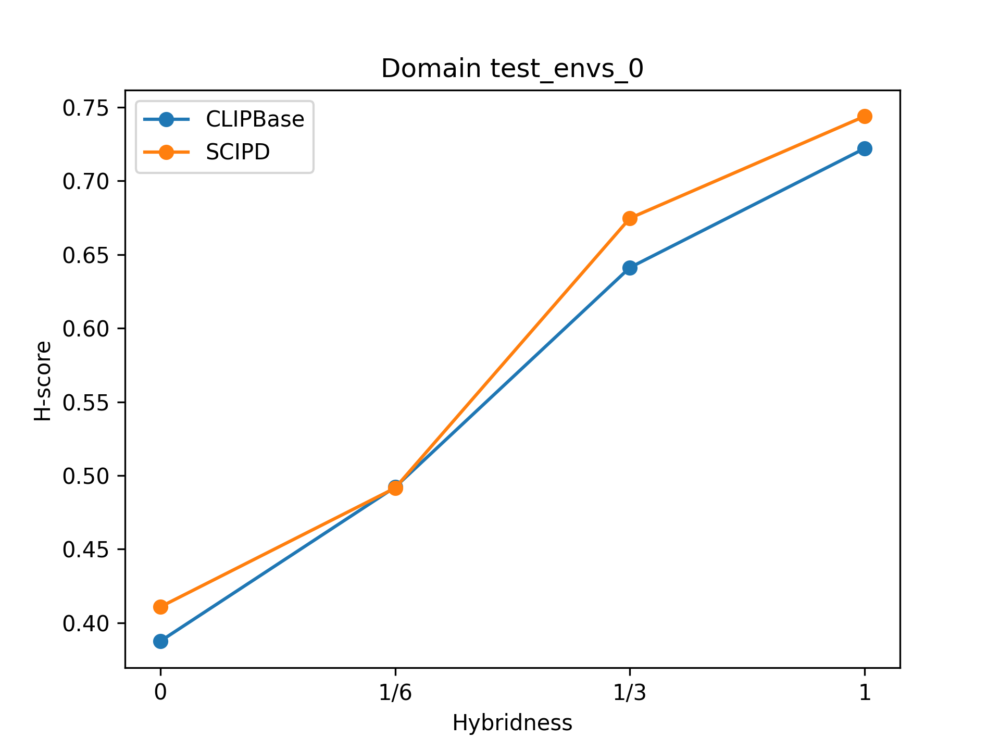

# PracticalDG 재현 (CVPR 2024)

**"PracticalDG: Perturbation Distillation on Vision-Language Models for Hybrid Domain Generalization"**
(Zining Chen et al., CVPR 2024, [arXiv:2404.09011](https://arxiv.org/abs/2404.09011)) 을
공식 코드 [znchen666/HDG](https://github.com/znchen666/HDG) 를 바탕으로 PACS 데이터셋에서 재현한 저장소입니다.

- **Hybrid DG**: 소스 도메인마다 클래스 공간이 다를 수 있고(hybridness H = 0, 1/6, 1/3, 1), 타깃 도메인에는 학습 때 못 본 unknown 클래스가 섞인 설정
- **비교 방법**: `CLIPBase` (CLIP ViT-B/16 → ResNet-18 distillation) vs 논문 제안 `SCIPD` (Score/Class/Instance 수준 perturbation distillation)
- **지표**: target acc (known 정확도), AUROC (known/unknown 구분), H-score (known·unknown 정확도의 조화평균)

## 재현 결과 (PACS, target = art_painting)

ResNet-18, 30 epoch × 100 step, seed 0, GPU 1장. 공식 설정보다 짧게 학습했으므로 절대 수치는 논문과 다를 수 있습니다.

| H | CLIPBase acc | **SCIPD acc** | CLIPBase AUROC | **SCIPD AUROC** | CLIPBase H-score | **SCIPD H-score** |
|:---:|:---:|:---:|:---:|:---:|:---:|:---:|
| 0   | 0.4053 | **0.4271** | 0.6724 | **0.7004** | 0.3875 | **0.4108** |
| 1/6 | 0.5485 | **0.5916** | 0.5614 | **0.6151** | **0.4921** | 0.4915 |
| 1/3 | 0.7567 | **0.7955** | 0.7065 | **0.7849** | 0.6412 | **0.6747** |
| 1   | 0.8449 | **0.8705** | 0.7918 | **0.8491** | 0.7221 | **0.7439** |

<p align="center"></p>

모든 H 에서 SCIPD 가 CLIPBase 보다 높은 acc / AUROC 를 보였고 H-score 도 4개 중 3개 구간에서 높아, 논문의 주장과 같은 방향의 결과를 얻었습니다.
집계 결과는 [`results/pacs/`](results/pacs) 에 있습니다 (체크포인트·로그는 용량 문제로 제외).

## 저장소 구성

**직접 작성·수정한 코드**

| 파일 | 내용 |
|---|---|
| `scripts/run_pacs.sh`, `run_pacs_all.sh`, `smoke_test.sh` | PACS 실험 1회 / 전체 8회 + 결과 그래프 / 1 epoch 동작 확인 |
| `check_setup.py` | 패키지·GPU·데이터셋·이미지 리스트 점검 |
| `utils/class_names.py` | 알고리즘 코드에 하드코딩돼 있던 클래스 이름 분리, PACS 지원, CLIP 프롬프트 토큰화 |
| `dalib/vision/datasets/pacs.py`, `officehome.py` | 특정 PC 폴더 구조에서만 동작하던 데이터 경로 처리를 어디서 받아도 동작하도록 수정 |
| `alg/algs/CLIPBase.py`, `SCIPD.py` | 공통 모듈을 쓰도록 리팩터링 (손실 계산은 원본과 동일) |
| `visualize/compare_clipbase_scipd.py` | 결과 파일 파싱 → H 별 acc / H-score 비교 CSV·그래프 (논문 Fig. 4) |
| `visualize/visualize_hyper.py`, `summarize_loss.py`, `threshold_val_*.py`, `compute_h2_cv.py` | 하이퍼파라미터 민감도(Fig. 5), 손실 ablation(Table 5), 검증 셋 기반 threshold 평가 집계·시각화 |
| `eval_hscore_val.py`, `scripts/run.sh`, `run_loss.sh`, `run_hyper.sh`, `run_val.sh` | OfficeHome 추가 실험 스크립트 (결과 미포함) |

**원본 코드**: `train.py`, `eval.py`, `eval_hscore.py`, `alg/`, `network/`, `datautil/`, `dalib/` 등 학습·평가 파이프라인은 HDG 코드이며,
위 수정과 `CUDA_VISIBLE_DEVICS` 오타 제거, `done.txt` epoch 기록 오류 수정 외에는 그대로 사용했습니다 (GPL-3.0).

## 실행

```bash
# 환경 (검증: Python 3.10, PyTorch 2.9.1 + CUDA 12.8)
pip install -r requirements.txt

# 데이터: PACS 를 <repo>/Dataset/PACS/{art_painting,cartoon,photo,sketch}/ 에 두거나 심볼릭 링크
python check_setup.py

# 동작 확인 (1 epoch, 수 분)
bash scripts/smoke_test.sh

# 재현 실험: CLIPBase vs SCIPD x H 0~3, target = art_painting (약 1시간 20분) -> results/pacs/
bash scripts/run_pacs_all.sh 0

# 1회만: <ALGO> <CLASS_SPACE 0~3> <TEST_ENV 0 art_painting|1 cartoon|2 photo|3 sketch>
bash scripts/run_pacs.sh SCIPD 3 0
```

결과는 `output/pacs/PACS_class_space{H}/{ALGO}/test_envs_{E}/seed_{S}/` 아래 `done.txt` (acc, AUROC) 와 `eval/eval_h_score.txt` (H-score) 에 저장됩니다.

## Citation

```bibtex
@inproceedings{chen2024practicaldg,
  title={PracticalDG: Perturbation Distillation on Vision-Language Models for Hybrid Domain Generalization},
  author={Chen, Zining and Wang, Weiqiu and Zhao, Zhicheng and Su, Fei and Men, Aidong and Meng, Hongying},
  booktitle={CVPR},
  year={2024}
}
```
